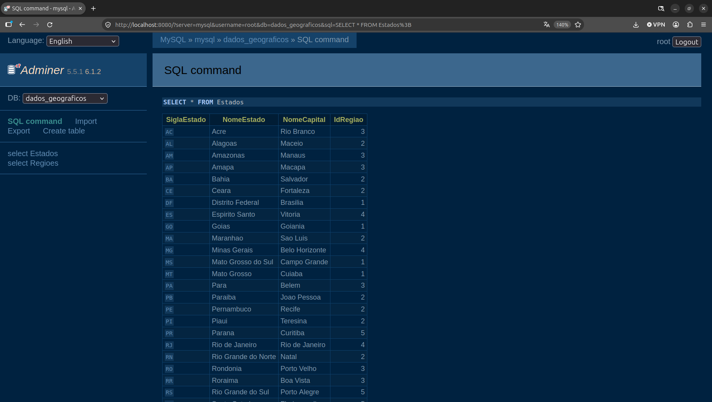
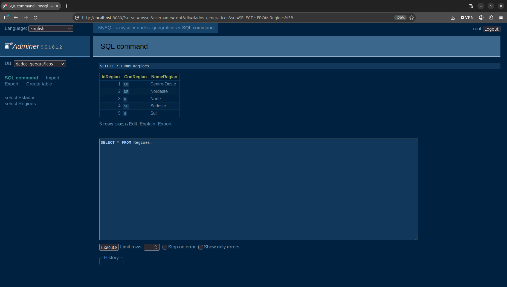

# grafanacloud-alloy-prometheus-loki-mysql-dockercompose_dadosgeograficos
Script do Docker Compose para criação de uma base MySQL com dados geográficas (Estados e Regiões do Brasil), com a coleta de métricas (Prometheus) + logs (Loki) via Grafana Alloy e consulta destas informações através da funcionalidade Queries overview (Database Observability) a partir do Grafana Cloud.

## Testes

Query para consulta de estados executada via Adminer (gerenciandor Web de MySQL):

E o mesmo tipo de consulta a regiões:

